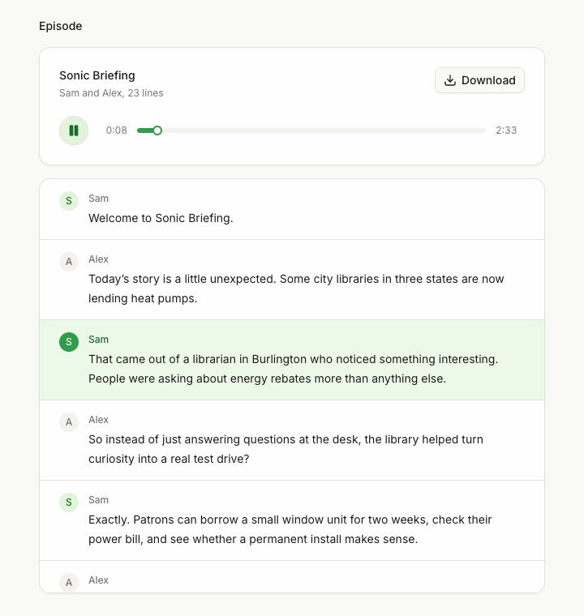

# Article to podcast

Turns a link or pasted text into a two-host podcast episode, with Cartesia Sonic 3.6 text to speech voicing each host in a different voice.



[](https://vercel.com/new/clone?repository-url=https%3A%2F%2Fgithub.com%2Fcartesia-ai%2Fcookbook%2Ftree%2Fmain%2Fexamples%2Farticle-to-podcast&env=CARTESIA_API_KEY%2CLLM_MODEL%2CAPP_PASSWORD&envDescription=Cartesia%20API%20key%2C%20an%20LLM%20as%20provider%2Fmodel%20%28on%20Vercel%20the%20AI%20Gateway%20needs%20no%20key%29%2C%20and%20a%20password%20for%20the%20app%20%28or%20none%29.&envLink=https%3A%2F%2Fgithub.com%2Fcartesia-ai%2Fcookbook%2Ftree%2Fmain%2Fexamples%2Farticle-to-podcast%23environment-variables&project-name=article-to-podcast&repository-name=article-to-podcast)

## Run it

Node 22.22 or newer.

```sh
npx degit cartesia-ai/cookbook/examples/article-to-podcast article-to-podcast
cd article-to-podcast
cp .env.example .env.local   # add CARTESIA_API_KEY, LLM_MODEL and its key
npm install
npm run dev
```

pnpm works too (`pnpm install`, `pnpm dev`).

Open http://localhost:3000, paste a link to an article (or switch to Paste text), set Length to Short and press Make podcast. Without keys the page still loads and shows a Finish setup notice naming what is missing. `GET /api/health` reports the same thing as booleans, never values.

## Environment variables

| Name | Required | What it does |
| --- | --- | --- |
| `CARTESIA_API_KEY` | yes | Records the audio. Get one at https://play.cartesia.ai/keys |
| `LLM_MODEL` | yes | The model that writes the script, as `provider/model`, for example `openai/gpt-5.4-mini` or `anthropic/claude-haiku-4-5` |
| `OPENAI_API_KEY` | if `LLM_MODEL` starts with `openai/` | https://platform.openai.com/api-keys |
| `ANTHROPIC_API_KEY` | if `LLM_MODEL` starts with `anthropic/` | https://console.anthropic.com |
| `AI_GATEWAY_API_KEY` | for any other provider | Routes the model through the [Vercel AI Gateway](https://vercel.com/docs/ai-gateway). Not needed on a Vercel deployment |
| `CARTESIA_VOICE_HOST_A`, `CARTESIA_VOICE_HOST_B` | no | Voice ids for the two hosts. Defaults are Skylar and Daniel |
| `APP_PASSWORD` | on Vercel | Optional locally. Required on Vercel (production and preview): a password for the whole app, or `none` to make it public. |
| `TRUST_PROXY` | no | Set to `1` behind your own reverse proxy so rate limits use the last `X-Forwarded-For` entry. Leave empty on Vercel. |

A direct key for the `LLM_MODEL` prefix wins. Any other prefix, or a prefix with no direct key, goes through the AI Gateway. The model ids are examples. Providers retire models, so check the provider's model page before you pick one. On Vercel, a model with no matching direct key goes through the AI Gateway without `AI_GATEWAY_API_KEY`, because the deployment authenticates to it for you.

## How it works

Your server fetches the URL, sends the article text to your LLM to write the script, and sends each script line to Cartesia. The browser never calls either provider.

Open these first:

1. `lib/tts.ts` makes one Sonic 3.6 call per script line with `client.tts.generate`, using host A's voice or host B's voice for that line. It asks for raw 16-bit PCM, so each line's length is exact, and `lib/wav.ts` joins the lines with short gaps (350 ms on a speaker change, 180 ms otherwise) and returns the start time of every line for the follow-along transcript. Four lines are recorded at a time.
2. `app/api/audio/route.ts` takes the script and returns one WAV, with the line start times in the `X-Line-Starts` header.
3. `lib/script.ts` asks the LLM (through the AI SDK) for the script as JSON. Long articles are split into parts, and each part sees the last six lines of the one before.

This is the call each line makes:

```ts
import Cartesia from "@cartesia/cartesia-js";

const client = new Cartesia({ apiKey: process.env.CARTESIA_API_KEY });

const res = await client.tts.generate({
  model_id: "sonic-3.6",
  transcript: "Welcome to the show. Today we're talking about heat pumps.",
  voice: { mode: "id", id: "db6b0ed5-d5d3-463d-ae85-518a07d3c2b4" },
  language: "en",
  output_format: { container: "raw", encoding: "pcm_s16le", sample_rate: 24000 },
});
const pcm = new Uint8Array(await res.arrayBuffer());
```

`lib/safe-fetch.ts` fetches the article and blocks private addresses at connection time, because a server that fetches user-supplied URLs can otherwise be pointed at internal services.

The SDK sends `Cartesia-Version: 2026-08-14` on every request. See https://docs.cartesia.ai/build-with-cartesia/tts-models/latest for current model ids.

## Change it

- Use other voices: pick two at https://play.cartesia.ai/voices and set `CARTESIA_VOICE_HOST_A` and `CARTESIA_VOICE_HOST_B`. The defaults are English voices, so set voices that match the language you pick.
- Change the show: the podcast name, tagline, host roles and dialogue structure are defaults in `lib/config.ts`. The prompt is in `lib/prompt.ts`.
- Use another LLM provider: set `LLM_MODEL` to its AI Gateway id, for example `google/<model id>`, with `AI_GATEWAY_API_KEY`. To call it directly instead, install its AI SDK package and add a branch for its prefix in `getModel` in `lib/llm.ts`. Some providers reject `temperature` for reasoning models. If yours rejects it, remove `temperature: o.creativity` in `lib/script.ts`.
- Set the temperature: the `creativity` option (0 to 1) in the request body becomes `temperature`. It is unset by default because reasoning models ignore temperature, and `openai/gpt-5.4-mini` is one. The UI does not send it, so set it from your own client or change the default in `lib/config.ts` when you use a model that reads it.

```ts
import { createGoogleGenerativeAI } from "@ai-sdk/google";

if (provider === "google" && env.GOOGLE_GENERATIVE_AI_API_KEY) {
  return createGoogleGenerativeAI({ apiKey: env.GOOGLE_GENERATIVE_AI_API_KEY })(bare);
}
```

`lib/llm.ts` is shared with the other LLM templates in this repo, so `pnpm check:copies` flags the edit there. In your own copy, edit it freely.

## Before you deploy

- Only convert articles you own or have permission to adapt. Label published audio as AI-generated.
- Set `APP_PASSWORD`. `proxy.ts` asks every visitor for it with HTTP Basic auth, and on Vercel (production and preview) the app refuses to serve until it is set (use `none` to make the app public on purpose). On hosts other than Vercel, set `APP_PASSWORD` yourself, because the gate only enforces it on Vercel.
- Both routes spend money (LLM tokens and Cartesia credits). Each has an in-memory rate limit per IP address (10 scripts and 5 recordings a minute). The limiter lives in one server process, so it only slows casual abuse. The password is the real guard. On Vercel the limiter keys on the client IP. On other hosts every caller shares one bucket, unless the app runs behind a proxy that appends the client IP to `x-forwarded-for` and you set `TRUST_PROXY=1`.
- Sonic bills per character of script, see https://docs.cartesia.ai/pricing. The audio route rejects scripts over 30,000 characters, which caps the cost of one episode, plus the LLM tokens.
- Both routes set `maxDuration = 300`. A script can have up to 120 lines, so a plan with a shorter function limit can cut a long episode off.
- A five minute episode is about 14 MB of WAV, and Vercel limits non-streamed function responses to 4.5 MB. The audio route streams the body in chunks, but this has not been tried on a deployment. If it fails there, switch to mp3 or store the file and return a link.

## FAQ

### Why one text to speech call per line instead of one long call?

Each host needs a different voice, and per-line calls give exact durations, which is what keeps the transcript in sync. The cost is that tone does not carry across lines. The short gaps hide most of it.

### Which languages work?

The Language menu has English, Spanish, French, German, Portuguese, Japanese, Hindi and Korean. The LLM writes in that language and Sonic gets the matching `language` code. The default voices are English, so for the most natural accent set host voices for that language from https://play.cartesia.ai/voices.

### Can I do this in Python?

The Sonic call is the same. Start from the [generate speech to a file](https://github.com/cartesia-ai/cookbook/blob/main/content/cookbook/10-python/01-generate-speech-to-file.mdx) recipe and loop over your script lines.

### Can the browser call Cartesia directly?

Not in this app; only the server holds the key. If you want it to, see [browser auth with access tokens](https://github.com/cartesia-ai/cookbook/blob/main/content/cookbook/00-guides/01-browser-auth-with-access-tokens.mdx).

## Tests

```sh
npm test
```

The tests need no keys and no network. They mock the Cartesia SDK and use `MockLanguageModelV4` from `ai/test`.

## Learn more

- Recipe: https://github.com/cartesia-ai/cookbook/blob/main/content/cookbook/01-next/02-article-to-podcast.mdx
- TTS bytes API: https://docs.cartesia.ai/api-reference/tts/bytes
- Laughter, speed and emotion: https://docs.cartesia.ai/build-with-cartesia/capability-guides/volume-speed-emotion
- Cartesia docs for agents: https://docs.cartesia.ai/llms.txt
- Agent skills: `npx skills add cartesia-ai/skills`

## License

Apache-2.0, like the rest of the [Cartesia cookbook](https://github.com/cartesia-ai/cookbook/blob/main/LICENSE).

Third-party notices: [THIRD_PARTY_NOTICES.md](THIRD_PARTY_NOTICES.md).
