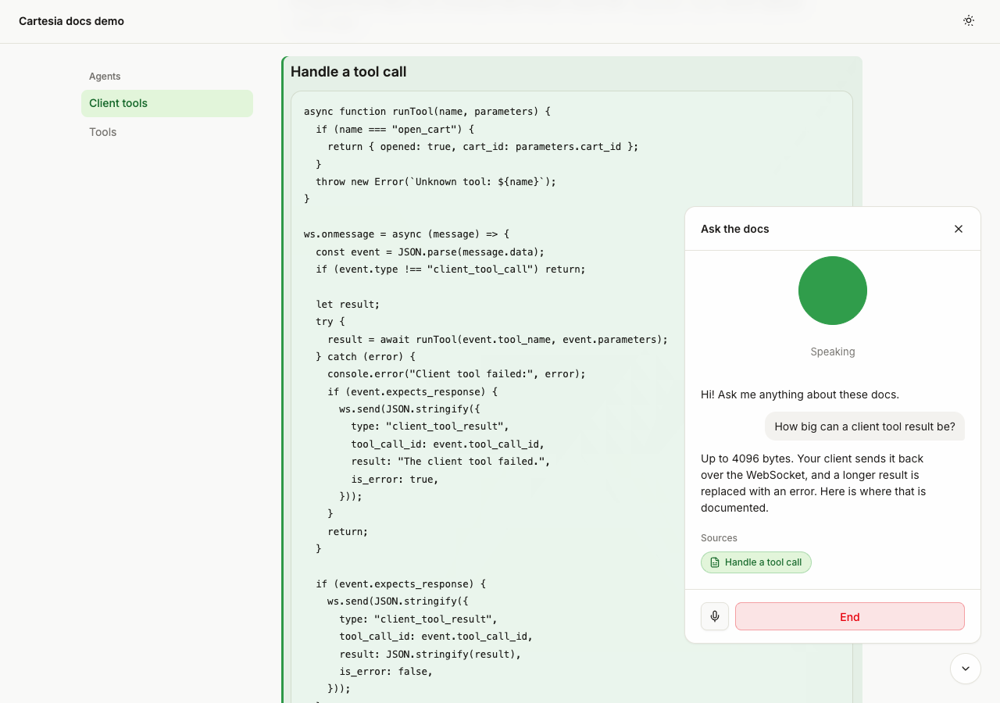

# Docs voice widget

Add a voice agent to any documentation site with one `<script>` tag: visitors ask a question out loud, and a Cartesia Managed Agent answers from your docs using client tools, cites the page and scrolls to the section it used.



## Run it

```sh
npx degit cartesia-ai/cookbook/examples/docs-voice-widget docs-voice-widget
cd docs-voice-widget
cp .env.example .env.local   # add CARTESIA_API_KEY
npm install
npm run setup:agent          # creates the agent and its two tools, saves the ids
npm run ingest               # indexes content/*.md into data/index.json
npm run dev
```

Node 22.22 or newer. pnpm works too.

Open http://localhost:4512, press **Ask the docs**, then **Start talking**, and ask "How big can a client tool result be?". The demo site is two pages copied from docs.cartesia.ai.

Only a Cartesia key is required. Without `OPENAI_API_KEY`, ingest builds a keyword index (BM25) and search ranks by matching words. Add the key and run `npm run ingest` again to switch to OpenAI embeddings, which handle paraphrased questions better.

### Add it to your site

```html
<script src="https://your-server.example.com/widget.js" defer></script>
```

Then set `ALLOWED_ORIGINS=https://docs.example.com` on the server and index your own pages:

```sh
npm run ingest -- ./my-docs --base-url /docs/                    # a folder of .md or .mdx
npm run ingest -- --sitemap https://docs.example.com/sitemap.xml # or a live site
```

Sitemap mode fetches `<page>.md` first (Mintlify and GitBook serve one) and falls back to the HTML, keeping the page's own heading ids so citations land on the right anchor. It only fetches pages, and follows redirects, on the sitemap's own host. Running ingest again only re-indexes pages whose content changed. Pages that fail to fetch keep their old sections in the index; ingest does not prune them. Only ingest sites you own or are allowed to index.

Optional attributes on the script tag: `data-theme="light|dark"` (default follows the page) and `data-title="Ask the docs"`. Host pages with a Content Security Policy need `connect-src wss://api.cartesia.ai https://your-server.example.com` and `worker-src blob:`.

## Environment variables

| Name | Required | What it does |
| --- | --- | --- |
| `CARTESIA_API_KEY` | yes | Mints access tokens and creates the agent. Get one at https://play.cartesia.ai/keys |
| `OPENAI_API_KEY` | no | Embeddings for ingest and search (`text-embedding-3-small`, 512 dimensions). Without it, search uses keywords |
| `CARTESIA_AGENT_ID`, `CARTESIA_TOOL_IDS` | yes | Written by `npm run setup:agent` |
| `ALLOWED_ORIGINS` | for your site | Comma-separated origins that may start sessions. The server's own origin is always allowed |
| `PUBLIC_URL`, `TRUST_PROXY` | behind a proxy | Public origin, and `1` to rate limit by the last `X-Forwarded-For` address, the one your proxy appended |
| `MAX_SESSION_SECS` | no | The widget ends a session after this many seconds. Default 300 |
| `PORT`, `WIDGET_TITLE`, `DEMO_SITE` | no | Port (default 4512), panel title (default "Ask the docs"), `0` turns off the demo site |
| `AGENT_MODEL_ID`, `CARTESIA_VOICE_ID`, `AGENT_LANGUAGE` | no | Read by `npm run setup:agent` |

## How it works

Open these first:

- `server/app.ts`: `POST /api/token` mints a token with `client.accessToken.create({ grants: { agent: true }, expires_in: 60 })` after the Origin check and rate limit. `POST /api/search` answers the client tool.
- `widget/src/tools.ts`: the browser side of the `search_docs` and `show_source` client tools.
- `server/search.ts`: ranking and packing results under Cartesia's 4,096-byte client tool result limit.

The flow:

1. The widget loads `GET /api/config` for the agent id. On **Start talking** it opens the mic, gets a token, and the vendored agents client opens `wss://api.cartesia.ai/v1/agents/websocket/{agent_id}`.
2. The agent calls `search_docs`. The browser forwards the query and the current path to `POST /api/search`, which ranks sections by cosine similarity (or BM25 without OpenAI) with a small boost for the current page, and packs the top four into a result under 3,800 bytes.
3. The agent calls `show_source` with a `source_id` from the results. The widget adds a source chip, and if the section is on this page it scrolls there and tints it. If the model answers without citing, the widget cites the top result itself.
4. Sources on other pages stay as chips. Clicking one during a call opens it in a new tab, since leaving the page ends the call. Chips only link to http(s) and relative URLs.

Search runs as a client tool, not a webhook tool, because Cartesia only calls public HTTPS webhooks. A client tool works against `localhost` with no tunnel.

Other files: `server/store.ts` (the JSON index), `server/keyword.ts` (BM25), `ingest/` (folder and sitemap sources, heading splitter), `widget/src/element.ts` (the `<cartesia-docs-agent>` element), `widget/src/highlight.ts` (scroll and tint), `scripts/agent-config.ts` (prompt and tool definitions).

## Change it

- Prompt and tools: edit `scripts/agent-config.ts`, then `npm run setup:agent -- --force` to create a new agent. Delete the old one at https://play.cartesia.ai.
- Model: the agent uses `ink-2` for speech recognition, `sonic-3.6` for speech and `gpt-4.1` as the LLM. Set `AGENT_MODEL_ID` to another id from https://docs.cartesia.ai/agents/models and run `npm run setup:agent -- --force`.
- Voice: set `CARTESIA_VOICE_ID` to a voice from https://play.cartesia.ai/voices before `npm run setup:agent`.
- Language: set `AGENT_LANGUAGE` to `es`, `fr`, `hi` or `ja`. The prompt already replies in the visitor's language.
- Vector store: `server/store.ts` is the only file that reads or writes the index. Replace it with pgvector or SQLite when a few thousand sections is not enough.
- Look: colors are in `widget/src/tokens.ts`, styles in `widget/src/styles.ts`.

Every request sends `Cartesia-Version: 2026-08-14`.

## Before you deploy

A public button that starts paid voice calls will be found. The token route checks `Origin` against `ALLOWED_ORIGINS` (403 otherwise), allows 4 tokens a minute and 30 an hour per IP, and never returns upstream errors. Search allows 30 calls a minute per IP. The agent ends calls after 60 seconds of silence and the widget ends sessions after `MAX_SESSION_SECS`.

The Origin check stops other websites, not scripts, which can send any header, so the rate limit is the real guard. The limiter is in memory and per process, so it only slows casual abuse. Put it in Redis or your edge if you run more than one process.

Cartesia records the audio and transcript of every agent call by default ([observability](https://docs.cartesia.ai/line/infrastructure/observability#call-recordings)). Tell your users, and delete calls you don't need with `DELETE /agents/calls/{call_id}`.

Cost: each call bills Managed Agents minutes on your Cartesia account, see https://docs.cartesia.ai/pricing. With `OPENAI_API_KEY` set, every search also embeds the question once.

Run `npm run build` and serve with `npm start`, which uses the built `dist/widget.js`. `GET /health` returns `{"ok":true}`.

## FAQ

### Why not use the Cartesia knowledge base?

Knowledge base folders work for agents too (https://docs.cartesia.ai/line/knowledge-base). This template keeps search in your server so the results carry page URLs and anchors, which the widget needs to scroll to the cited section.

### Does it work on Docusaurus, Mintlify or Nextra?

Yes, anywhere you can add a script tag. Ingest from the site's sitemap so anchors match its heading ids. The widget follows `html.dark`, `html[data-theme]` or the OS setting for dark mode.

### Why does the call end when I click a link to another page?

The call lives in the page. A multi-page site reloads on navigation, so sources on other pages open in a new tab during a call.

## Tests

```sh
npm test
npm run typecheck
```

## Learn more

- Recipe: https://github.com/cartesia-ai/cookbook/blob/main/content/cookbook/15-agents/04-voice-search-for-your-docs.mdx
- Managed Agents: https://docs.cartesia.ai/agents/introduction
- Client tools: https://docs.cartesia.ai/agents/client-tools
- WebSocket API: https://docs.cartesia.ai/line/integrations/websocket-api
- Browser auth guide: https://github.com/cartesia-ai/cookbook/blob/main/content/cookbook/00-guides/01-browser-auth-with-access-tokens.mdx
- Agent skills: `npx skills add cartesia-ai/skills`

## License

Apache-2.0, like the rest of the [Cartesia cookbook](https://github.com/cartesia-ai/cookbook/blob/main/LICENSE).

Third-party notices: [THIRD_PARTY_NOTICES.md](THIRD_PARTY_NOTICES.md).
