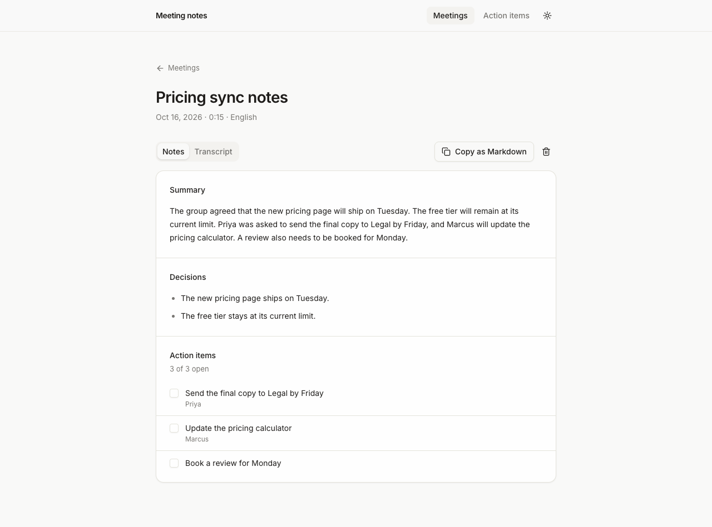

# Meeting notes

Records or uploads a meeting, transcribes it with Cartesia batch speech to text (`ink-whisper`), and asks an LLM for a title, a summary, the decisions and the action items with owners.



[](https://vercel.com/new/clone?repository-url=https%3A%2F%2Fgithub.com%2Fcartesia-ai%2Fcookbook%2Ftree%2Fmain%2Fexamples%2Fmeeting-notes&env=CARTESIA_API_KEY%2CLLM_MODEL%2CAPP_PASSWORD&envDescription=Cartesia%20API%20key%2C%20an%20LLM%20as%20provider%2Fmodel%20%28on%20Vercel%20the%20AI%20Gateway%20needs%20no%20key%29%2C%20and%20a%20password%20for%20the%20app%20%28or%20none%29.&envLink=https%3A%2F%2Fgithub.com%2Fcartesia-ai%2Fcookbook%2Ftree%2Fmain%2Fexamples%2Fmeeting-notes%23environment-variables&project-name=meeting-notes&repository-name=meeting-notes)

## Run it

```sh
npx degit cartesia-ai/cookbook/examples/meeting-notes meeting-notes
cd meeting-notes
cp .env.example .env.local
npm install
npm run dev
```

Before `npm run dev`, add `CARTESIA_API_KEY`, `LLM_MODEL` and the matching provider key to `.env.local`. pnpm works too. Node 22.22 or newer.

Open http://localhost:3000, press Start recording and talk for a few seconds, then press Stop and write notes. Or switch to Upload, choose an audio file and press Write notes. If a key is missing, the page says which one.

Meetings are saved in your browser's IndexedDB, so there is no database to set up.

## Environment variables

| Name | Required | Where to get it |
| --- | --- | --- |
| `CARTESIA_API_KEY` | yes | https://play.cartesia.ai/keys |
| `LLM_MODEL` | yes | `provider/model`, for example `openai/gpt-5.4-mini` or `anthropic/claude-haiku-4-5` |
| `OPENAI_API_KEY` | if `LLM_MODEL` starts with `openai/` | https://platform.openai.com/api-keys |
| `ANTHROPIC_API_KEY` | if `LLM_MODEL` starts with `anthropic/` | https://console.anthropic.com |
| `AI_GATEWAY_API_KEY` | for any other provider | https://vercel.com/docs/ai-gateway |
| `APP_PASSWORD` | on Vercel | Optional locally. Required on Vercel (production and preview): a password for the whole app, or `none` to make it public. |
| `TRUST_PROXY` | no | Set to `1` behind your own reverse proxy so rate limits use the last `X-Forwarded-For` entry. Leave empty on Vercel. |

The model ids are examples. Providers retire models, so check the provider's model page before you pick one. On Vercel, a model with no matching direct key goes through the AI Gateway without `AI_GATEWAY_API_KEY`, because the deployment authenticates to it for you.

## How it works

Open these first:

1. `app/api/transcribe/route.ts` takes the audio file and calls `client.stt.transcribe` with `model: "ink-whisper"`. Batch transcription uses `ink-whisper` because the batch `/stt` endpoint accepts only that model; `ink-2` is streaming only.
2. `app/api/summarize/route.ts` sends the transcript to the AI SDK's `generateText` with `Output.object` and the zod schema in `lib/schema.ts`.
3. `lib/pipeline.ts` runs in the browser. It posts the recording (24 kbps Opus from `MediaRecorder`) or the upload to both routes, saves the transcript to IndexedDB as soon as it arrives, and keeps it if the summary fails so you can retry.

This is the Cartesia call:

```ts
import Cartesia from "@cartesia/cartesia-js";

const client = new Cartesia({ apiKey: process.env.CARTESIA_API_KEY });
const res = await client.stt.transcribe({ file, model: "ink-whisper", language: "en" });
console.log(res.text, res.duration);
```

`CARTESIA_API_KEY` is read only on the server, in `lib/cartesia.ts`. Audio is never stored: the route transcribes it and drops it. The SDK sends `Cartesia-Version: 2026-08-14` on every request.

## Change it

- Transcribe another language: pick it in the language menu. The list is `LANGUAGES` in `lib/limits.ts`; `ink-whisper` accepts more, so add their ISO 639-1 codes there.
- Use another LLM: set `LLM_MODEL`. `lib/llm.ts` is the whole switch. For another direct provider, add its AI SDK package and one branch there.
- Change what the notes contain: edit `lib/schema.ts` and the instructions in `lib/prompt.ts`.
- Store notes on a server: replace the four async functions in `lib/store.ts` with calls to your database and keep the hooks.

## Before you deploy

- Set `APP_PASSWORD`. `proxy.ts` asks every visitor for it with HTTP Basic auth, and on Vercel (production and preview) the app refuses to serve until it is set (use `none` to make the app public on purpose). On hosts other than Vercel, set `APP_PASSWORD` yourself, because the gate only enforces it on Vercel.
- Both routes spend money. Each has an in-memory rate limit of 10 requests a minute per IP address. The limiter lives in one server process, so it only slows casual abuse. The password is the real guard. On Vercel the limiter keys on the client IP. On other hosts every caller shares one bucket, unless the app runs behind a proxy that appends the client IP to `x-forwarded-for` and you set `TRUST_PROXY=1`.
- Batch `ink-whisper` bills per second of audio, silence included, plus one LLM call per meeting. See https://docs.cartesia.ai/pricing.
- Uploads are capped at 4 MB, because Vercel rejects request bodies over 4.5 MB. The recorder stops at 3.6 MB or 20 minutes. On a host without that limit you can raise `MAX_AUDIO_BYTES` in `lib/limits.ts`.
- There is no chunking. Transcripts over about 120,000 characters are rejected.
- There are no speaker labels. `ink-whisper` does not return them, so an action item's owner comes only from names said in the meeting, and the prompt tells the model not to guess.

## FAQ

### Can I get a live transcript while the meeting is happening?

Not with this app. It sends the whole recording when you stop. For live captions, stream the microphone to `ink-2` over the STT WebSocket; https://docs.cartesia.ai/build-with-cartesia/stt/latest covers it.

### Can the browser call Cartesia directly?

Not in this app; only the server holds the key. If you want it to, see [browser auth with access tokens](https://github.com/cartesia-ai/cookbook/blob/main/content/cookbook/00-guides/01-browser-auth-with-access-tokens.mdx).

### Can I do this in Python?

Yes. The `cartesia` package has the same call:

```python
import os
from cartesia import Cartesia

client = Cartesia(api_key=os.environ["CARTESIA_API_KEY"])
with open("meeting.wav", "rb") as f:
    res = client.stt.transcribe(file=f, model="ink-whisper", language="en")
print(res.text)
```

## Tests

```sh
npm test
```

## Learn more

- Recipe: [Transcribe and summarize meetings](https://github.com/cartesia-ai/cookbook/blob/main/content/cookbook/01-next/20-transcribe-and-summarize-meetings.mdx)
- Compare STT endpoints: https://docs.cartesia.ai/use-the-api/stt/compare-endpoints
- Batch transcription API: https://docs.cartesia.ai/api-reference/stt/transcribe
- Cartesia docs for agents: https://docs.cartesia.ai/llms.txt

## License

Apache-2.0, like the rest of the [Cartesia cookbook](https://github.com/cartesia-ai/cookbook/blob/main/LICENSE).
