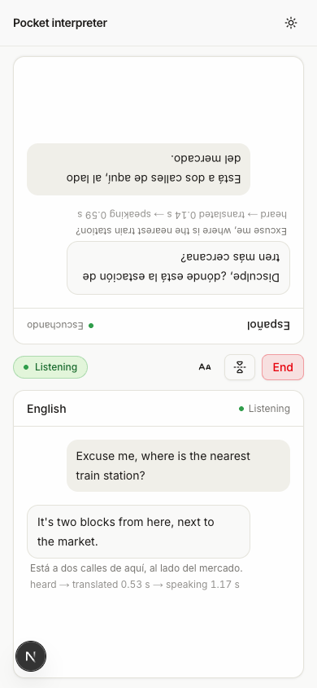
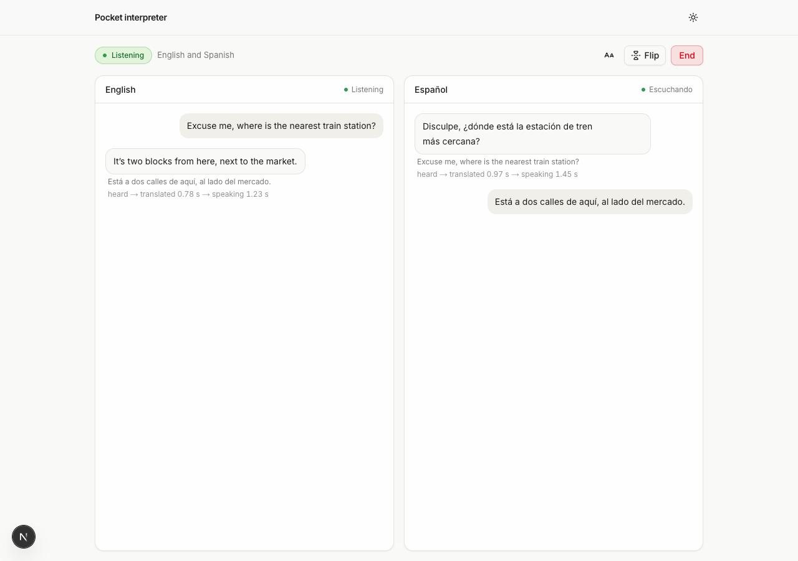

# Pocket interpreter: real-time voice translation between two people on one phone

A Next.js app for two people who don't share a language. Each person speaks their own, Cartesia Ink 2 streams the speech to text and finds the end of each turn, an LLM translates it, and Cartesia Sonic 3.6 says it out loud in the other language. The screen splits in two so each person reads the conversation in their own language, and one half can turn upside down for a phone lying flat between you.



Languages: English, Spanish, French, Hindi and Japanese, any two of them. These are the five languages Ink 2 streams today.

## Run it

```sh
pnpm dlx create-next-app --example https://github.com/cartesia-ai/cookbook/tree/main/examples/pocket-interpreter my-interpreter
cd my-interpreter
cp .env.example .env.local   # add CARTESIA_API_KEY, LLM_MODEL and the provider key
pnpm dev
```

Open http://localhost:3000, pick the two languages, press Start talking and say something. A phone needs HTTPS for the microphone, so to try it on one, deploy it or use a tunnel such as `cloudflared tunnel --url http://localhost:3000`.

If a key is missing, the page says which one.

## Environment variables

| Name | Required | Where to get it |
| --- | --- | --- |
| `CARTESIA_API_KEY` | yes | https://play.cartesia.ai/keys |
| `LLM_MODEL` | yes | `provider/model`, for example `openai/gpt-5.4-mini` or `anthropic/claude-haiku-4-5` |
| `OPENAI_API_KEY` | if `LLM_MODEL` starts with `openai/` | https://platform.openai.com/api-keys |
| `ANTHROPIC_API_KEY` | if `LLM_MODEL` starts with `anthropic/` | https://console.anthropic.com |
| `AI_GATEWAY_API_KEY` | for any other provider | https://vercel.com/docs/ai-gateway |

Those model ids are examples. Providers retire models, so check the provider's model page first.

## How it works

1. Start talking calls `POST /api/token`. The route uses `CARTESIA_API_KEY` to mint a 60 second access token with the `stt` and `tts` grants and nothing else. The key never reaches the browser.
2. The browser opens two WebSockets with that token: Ink 2 on `/stt/turns/websocket` for the microphone, and Sonic for speech. A sixty second token is enough because each socket only needs it to connect. If a socket closes later, the page asks for a new token.
3. Ink 2 sends `turn.start`, `turn.update` (the live caption), `turn.eager_end` and `turn.end`. On `turn.eager_end` the page already asks `POST /api/translate` for a translation. If `turn.end` arrives with the same words, that request is reused, which saves most of the LLM's time to first token. If the speaker keeps going (`turn.resume`), the request is cancelled.
4. Ink 2 detects the language on its own but does not report it, so `/api/translate` does both jobs in one streamed reply: the language code of the turn on the first line, the translation after it. The code says who spoke, and that decides which voice and which side of the screen.
5. Sentences go to Sonic 3.6 while the LLM is still writing, in a voice made for the target language. Audio is played with Web Audio as chunks arrive.
6. While a translation plays, the microphone sends silence to Ink 2. Otherwise the app would hear its own voice and translate it back, forever.

Under each translated turn, a small line shows the time from the end of the turn to the first translated word, then to the first audio. In testing, with `openai/gpt-5.4-mini`, the first audio started 0.6 to 1.5 s after the speaker stopped.

The streaming part of the translate route, from `lib/translate-route.ts`:

```ts
import { streamText } from "ai";

const result = streamText({
  model,                          // from LLM_MODEL, see lib/llm.ts
  system: translatePrompt(pair),  // "reply with en or es on the first line, then the translation"
  prompt: text,                   // one Ink 2 turn
  maxOutputTokens: 600,
  abortSignal: req.signal,        // the page cancels a speculative translation by aborting the fetch
});
return result.toTextStreamResponse();
```

And the Ink 2 connection in the browser, from `lib/audio/listener.ts`:

```ts
import Cartesia from "@cartesia/cartesia-js";

const client = new Cartesia({ token });
const ws = client.stt.autoFinalize.websocket({
  model: "ink-2",
  encoding: "pcm_f32le",
  sample_rate: audioCtx.sampleRate,
});
for await (const event of ws.stream()) {
  if (event.type !== "message") continue;
  if (event.message.type === "turn.end") onTurnEnd(event.message.transcript);
}
```

```
app/api/token        mints the 60 second browser token
app/api/translate    streams "<code>\n<translation>" from the LLM
app/api/health       booleans for the setup banner
lib/interpreter.ts   the turn loop: Ink 2 turns in, translation, Sonic out, latency
lib/audio/           mic capture with the mute gate, Ink 2 listener, Sonic speaker
lib/languages.ts     the five languages, their voices, and each side's words
components/          setup form and the split conversation
```



## Models and API version

Uses `ink-2` for streaming speech to text, `sonic-3.6` for speech, and `Cartesia-Version: 2026-08-14` (the SDK sends it). See https://docs.cartesia.ai/build-with-cartesia/stt/latest and https://docs.cartesia.ai/build-with-cartesia/tts-models/latest for current ids.

## Change it

- Use a different voice: change `VOICES` in `lib/languages.ts`. Pick one from https://play.cartesia.ai/voices whose language is the target language, or use your own clone.
- Change the words on each side: `COPY` in `lib/languages.ts`.
- Swap the LLM: set `LLM_MODEL`. `lib/llm.ts` is the whole switch.
- Change how the model translates (formal or casual, keep units): edit `lib/prompt.ts`. Keep the first-line language code, the parser in `lib/translation.ts` depends on it.
- Tune turn detection: pass `turn_end_threshold` or `turn_end_timeout_ms` to the websocket call in `lib/audio/listener.ts`. See https://docs.cartesia.ai/use-the-api/stt/turns.

## FAQ

### How do I keep my Cartesia API key out of the browser?

The key stays in `/api/token`, which mints a 60 second access token that can only open speech-to-text and text-to-speech sockets. See [Authenticate your applications](https://docs.cartesia.ai/get-started/authenticate-your-client-applications).

### Can both people talk at the same time?

No. There is one microphone, and the app handles one turn at a time. While a translation plays, the microphone is muted for Ink 2, so wait for it to finish. Ink 2 can tell a pause from the end of a sentence, so you don't need to press anything between turns.

### Why only five languages?

Ink 2 streams English, Spanish, French, Hindi and Japanese. Sonic speaks more, so if you only need the voice side in another language, the speaker in `lib/audio/speaker.ts` already takes any Sonic language code.

### Does it work on a phone?

Yes, the layout is built for a phone first. Browsers only allow the microphone on HTTPS or localhost, so serve it over HTTPS. It was tested in desktop Chrome with a recorded voice as the microphone, not on a real phone.

### Does it need headphones?

No. The app mutes its own input while it speaks, plus 0.35 seconds for the echo. In a loud room, background voices can still start a stray turn.

## Before you deploy

`/api/token` and `/api/translate` have no auth. The token route has a small in-memory rate limit, which only slows down casual abuse. Put the app behind your own login before you share the URL, or anyone can spend your Cartesia and LLM credits.

## Learn more

- Cartesia docs: https://docs.cartesia.ai
- [Browser auth with access tokens](../../content/cookbook/00-guides/01-browser-auth-with-access-tokens.mdx)
- Ink 2 turn events: https://docs.cartesia.ai/use-the-api/stt/turns
- Agent skills: `npx skills add cartesia-ai/skills`

## License

Apache-2.0, like the rest of the [Cartesia cookbook](https://github.com/cartesia-ai/cookbook/blob/main/LICENSE).
