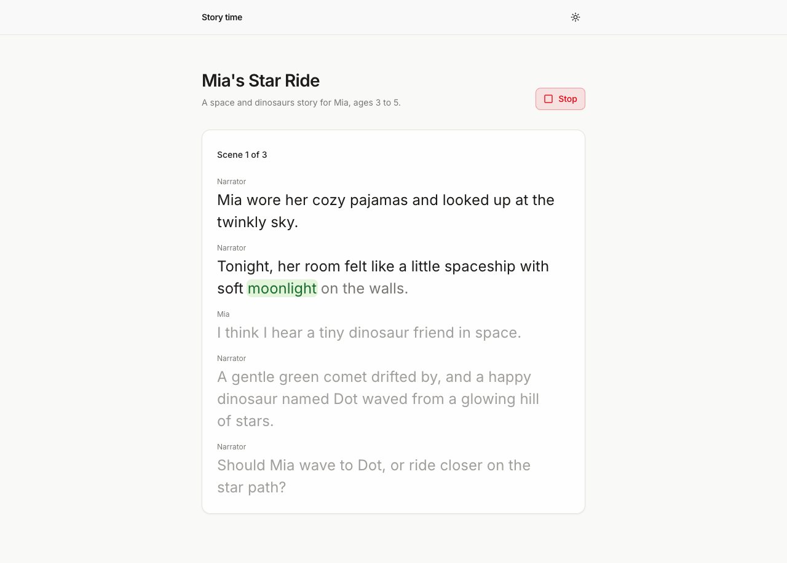

# Story time

An interactive story app where Sonic voices every character and you choose what happens next. An LLM writes each scene, Cartesia Sonic 3.6 reads it with word-by-word highlighting, and you tap a choice or say it to Cartesia Ink 2.



Each story has three short scenes, and the page highlights each word as it is spoken.

## Run it

```sh
npx degit cartesia-ai/cookbook/examples/story-time story-time
cd story-time
cp .env.example .env.local
npm install
npm run dev
```

Node 22.22 or newer. pnpm works too.

Before `npm run dev`, add `CARTESIA_API_KEY`, `LLM_MODEL` and the matching provider key to `.env.local`.

Open [localhost:3000](http://localhost:3000), pick a theme and a tone, optionally name the hero, and press Start the story. When the narrator asks what to do, tap a choice, or press Answer out loud and say "the first one" or "the rocket". If a key is missing, the page says which one.

## Environment variables

| Name | Required | Where to get it |
| --- | --- | --- |
| `CARTESIA_API_KEY` | yes | [play.cartesia.ai/keys](https://play.cartesia.ai/keys) |
| `LLM_MODEL` | yes | `provider/model`, for example `openai/gpt-5.4-mini` |
| `OPENAI_API_KEY` | if `LLM_MODEL` starts with `openai/`; recommended for any model | [platform.openai.com/api-keys](https://platform.openai.com/api-keys). Also turns on scene moderation, whatever model writes the story. |
| `ANTHROPIC_API_KEY` | if `LLM_MODEL` starts with `anthropic/` | [console.anthropic.com](https://console.anthropic.com) |
| `AI_GATEWAY_API_KEY` | for any other provider | [Vercel AI Gateway](https://vercel.com/docs/ai-gateway) |
| `APP_PASSWORD` | on Vercel | Optional locally. Required on Vercel (production and preview): a password for the whole app, or `none` to make it public. |
| `TRUST_PROXY` | no | Set to `1` behind your own reverse proxy so rate limits use the last `X-Forwarded-For` entry. Leave empty on Vercel. |

The model ids above are examples. Providers retire models, so check the provider's model page before you pick one.

## How it works

Open these first:

- `lib/narrate.ts` opens the Sonic WebSocket, one context per line, and schedules the audio.
- `lib/listen.ts` streams the microphone to Ink 2 and waits for the end of the turn.
- `app/api/scene/route.ts` asks the LLM for the next scene and runs the safety checks.

1. `POST /api/scene` sends the hero's name (if you gave one), the themes, the tone and the story so far to the LLM with `generateText` and a zod schema (`lib/story.ts`). The model returns 4 to 7 lines, each with a speaker and an emotion, plus two choices (none in the last scene).
2. `POST /api/token` mints a 60 second Cartesia access token with the `tts` and `stt` grants. The browser gets a fresh one for every WebSocket, so `CARTESIA_API_KEY` stays on the server.
3. The browser opens one Sonic WebSocket per scene and one context per line, with that speaker's voice, the line's emotion and `add_timestamps`. Audio chunks are scheduled back to back on a Web Audio clock, and the word timestamps drive the read-along highlight.
4. When you press Answer out loud, the browser streams the microphone to Ink 2 on `/stt/turns/websocket`. On `turn.eager_end` or `turn.end` it matches the words to a choice (`lib/match-choice.ts`). Only the chosen option goes back to the LLM, never the transcript. The mic stays off until you press the button.
5. The story, and the recorded narration with its timestamps, are saved in IndexedDB. Replaying a scene from the library makes no API calls.

```ts
const c = ws.context({
  model_id: "sonic-3.6",
  voice: { mode: "id", id: voiceOf(line.speaker) },
  output_format: { container: "raw", encoding: "pcm_f32le", sample_rate: 24000 },
  language: "en",
  add_timestamps: true,
  use_normalized_timestamps: false,
});
await c.push({
  transcript: spokenText(line.text),
  ...(line.emotion === "neutral" ? {} : { generation_config: { emotion: line.emotion } }),
});
await c.no_more_inputs();
for await (const ev of c.receive()) {
  if (ev.type === "chunk") play(ev.audio);
  else if (ev.type === "timestamps") words.push(...ev.word_timestamps.words);
}
```

```
app/api/scene/route.ts    writes a scene with the LLM, checks the format, the word list and moderation
app/api/token/route.ts    60 second Cartesia token, rate limited
app/story/[id]            the player: read-along, choices, replay
lib/narrate.ts            Sonic WebSocket, scheduling, recording
lib/listen.ts             mic capture and Ink 2 turns
lib/prompt.ts             storyteller and content rules
lib/store.ts              the only file that touches IndexedDB
```

Uses `sonic-3.6` for narration, `ink-2` for the spoken choice, and `Cartesia-Version: 2026-08-14` (set by `@cartesia/cartesia-js`). See the [TTS models](https://docs.cartesia.ai/build-with-cartesia/tts-models/latest) and [STT models](https://docs.cartesia.ai/build-with-cartesia/stt/latest) pages for current ids. Emotion control is in beta and English only; the voices in `lib/story.ts` are the ones the docs list as the most emotive.

## Change it

- Use different voices: edit `VOICES`, `NARRATORS` and `CHARACTER_POOL` in `lib/story.ts`. Pick ids from the [voice library](https://play.cartesia.ai/voices).
- Make longer stories: change `TOTAL_SCENES` in `lib/story.ts`. Each scene costs one LLM call and its narration in Sonic.
- Tell stories in Spanish, French, Hindi or Japanese: Ink 2 and Sonic both speak them. Set `language` in `lib/narrate.ts`, add the language to the prompt, translate the ordinals and stopwords in `lib/match-choice.ts` and the word list in `lib/safety.ts`, and drop `generation_config.emotion`, which is English only. Ink 2 takes no language setting, so `lib/listen.ts` stays as it is.
- Swap the LLM: set `LLM_MODEL`. `lib/llm.ts` is the whole switch.

## Before you deploy

### Where data goes

- Your story settings, any character name and your choices go to the LLM provider in `LLM_MODEL` to write each scene, and to OpenAI's moderation endpoint when `OPENAI_API_KEY` is set.
- When you answer out loud, your voice streams to Cartesia Ink 2 for transcription. The transcript stays in the browser.
- The app saves stories and their narration in the browser (IndexedDB). Its server stores no audio and no stories. Cartesia's and your LLM provider's own data retention policies apply.

Say this in your own privacy notice if you put the app in front of other people.

### Content safety

- The only free text on the setup screen is an optional character name, limited to letters, spaces, hyphens and apostrophes. Themes and tones are presets.
- The system prompt in `lib/prompt.ts` bans graphic violence, sexual content, hate, real people and brands, and tells the model to treat the name as a name only.
- When `OPENAI_API_KEY` is set, the scene route sends the settings, and then every scene before it is narrated, to OpenAI's moderation endpoint (`omni-moderation-latest`, free to call). This runs whatever `LLM_MODEL` writes the story. A flagged name stops the request with a fixed message. A flagged scene is written again once, then the page says "This story wandered somewhere it shouldn't. Let's start a new one." If the moderation call fails, no scene is sent. Without the key, the setup banner says moderation is off. See the [OpenAI moderation guide](https://platform.openai.com/docs/guides/moderation).
- A short word list in `lib/safety.ts` runs on the name, the title and every scene as a backstop, with or without moderation. It also catches swear words in a name, which the moderation model lets through.

Moderation and a word list lower the risk; they do not remove it. Test the app with your own prompts before you ship it, and check that your use fits the [Cartesia acceptable use policy](https://www.cartesia.ai/legal/acceptable-use).

### Auth, limits and cost

Set `APP_PASSWORD` before you deploy. `proxy.ts` then asks for that password (HTTP Basic auth, any username) on every page and API route. On Vercel (production and preview) the app returns 503 until `APP_PASSWORD` is set, or set to `none` to make the app public. On hosts other than Vercel, set `APP_PASSWORD` yourself, because the gate only enforces it on Vercel. `/api/token` and `/api/scene` also have an in-memory rate limit of 10 requests a minute per client IP. It is per process and only slows casual abuse; the password is the real guard. On Vercel the limiter keys on the client IP. On other hosts every caller shares one bucket, unless the app runs behind a proxy that appends the client IP to `x-forwarded-for` and you set `TRUST_PROXY=1`.

Each scene costs one LLM call plus Sonic characters for its narration, and each spoken answer costs Ink 2 streaming time. See [docs.cartesia.ai/pricing](https://docs.cartesia.ai/pricing) for current rates.

## FAQ

The browser never sees `CARTESIA_API_KEY`. [Browser auth with access tokens](https://github.com/cartesia-ai/cookbook/blob/main/content/cookbook/00-guides/01-browser-auth-with-access-tokens.mdx) explains the token route.

### How do I give each character a different voice?

Open one Sonic WebSocket and create a context per line with that line's voice id. Contexts on one connection are independent, so the narrator, the hero and a talking dragon can alternate without reconnecting. `lib/cast.ts` gives each new speaker the next voice in the pool.

### How does the read-along highlight work?

Sonic sends `timestamps` events with word start times when `add_timestamps` is on. The page knows when each line started on the Web Audio clock, so on every animation frame it finds the word whose start time has passed. `lib/align.ts` maps Sonic's words onto the words on screen.

### Can I just say the answer?

Yes. Press Answer out loud, then speak. Ink 2 detects when you stop talking, so there is no button to hold. "The second one", "number two", "the rocket" and "hop" all work. If the answer is unclear the page says so and keeps listening, and the choice buttons always work. The mic never opens on its own.

### Why does the first scene take a few seconds?

The LLM writes the whole scene before Sonic starts, so a smaller model makes the wait shorter. Narration starts on the first audio chunk, and later lines are generated while earlier ones play.

## Tests

```sh
npm test
```

## Learn more

- Recipe: https://github.com/cartesia-ai/cookbook/blob/main/content/cookbook/01-next/30-multi-voice-narration-with-word-timestamps.mdx
- Cartesia docs: https://docs.cartesia.ai
- Contexts on the TTS WebSocket: https://docs.cartesia.ai/use-the-api/tts-websocket/contexts
- Turn detection with Ink 2: https://docs.cartesia.ai/use-the-api/stt/turns
- Volume, speed and emotion: https://docs.cartesia.ai/build-with-cartesia/capability-guides/volume-speed-emotion
- Agent skills: `npx skills add cartesia-ai/skills`

## License

Apache-2.0, like the rest of the [Cartesia cookbook](https://github.com/cartesia-ai/cookbook/blob/main/LICENSE). Third-party notices: [THIRD_PARTY_NOTICES.md](THIRD_PARTY_NOTICES.md).
