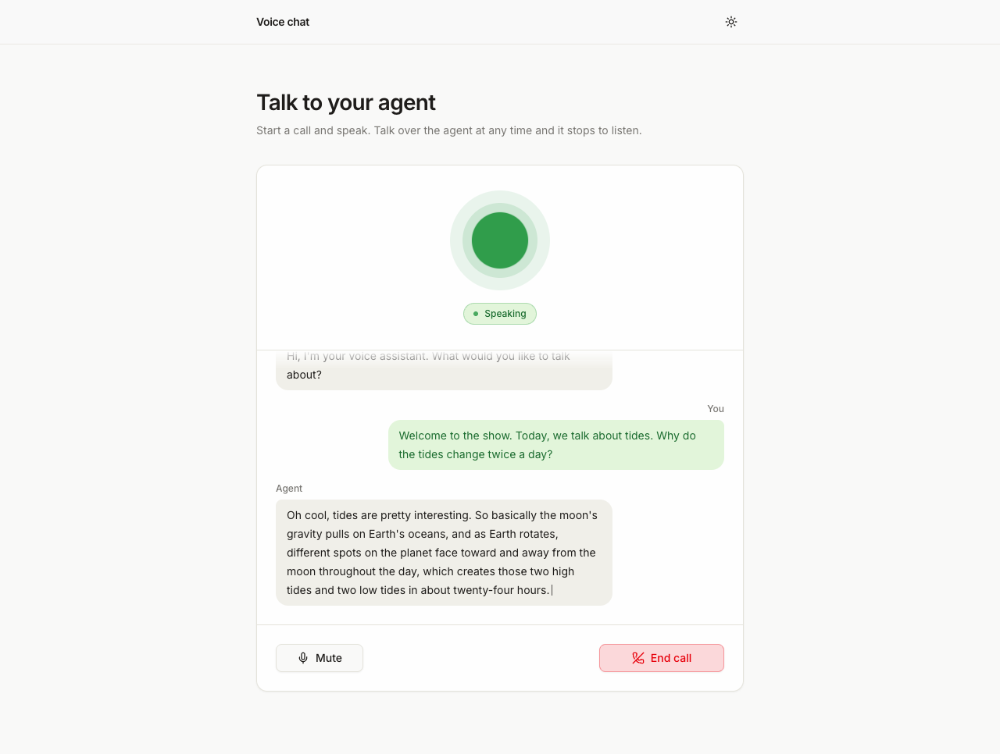

# Voice chat

A Next.js app for a real-time voice conversation in the browser with a Cartesia Managed Agent (Ink 2 speech to text, an LLM and Sonic 3.6 text to speech, run by Cartesia).



Run `npm run setup:agent` on your machine before you press this button. The button asks for `CARTESIA_AGENT_ID`, and that id only exists after the setup script has created the agent (see Run it below). If you deploy without it, the page shows setup steps instead of the call.

[](https://vercel.com/new/clone?repository-url=https%3A%2F%2Fgithub.com%2Fcartesia-ai%2Fcookbook%2Ftree%2Fmain%2Fexamples%2Fvoice-chat&env=CARTESIA_API_KEY%2CCARTESIA_AGENT_ID%2CAPP_PASSWORD&envDescription=Cartesia%20API%20key%20from%20play.cartesia.ai%2Fkeys%2C%20the%20agent%20id%20from%20running%20npm%20run%20setup%3Aagent%20locally%2C%20and%20a%20password%20for%20the%20app%20%28or%20none%29.&envLink=https%3A%2F%2Fgithub.com%2Fcartesia-ai%2Fcookbook%2Ftree%2Fmain%2Fexamples%2Fvoice-chat%23environment-variables&project-name=voice-chat&repository-name=voice-chat)

## Run it

Node 22.22 or newer. You need a Cartesia API key from https://play.cartesia.ai/keys.

```sh
npx degit cartesia-ai/cookbook/examples/voice-chat voice-chat
cd voice-chat
cp .env.example .env.local   # add CARTESIA_API_KEY
npm install
npm run setup:agent          # creates the agent and writes CARTESIA_AGENT_ID to .env.local
npm run dev
```

pnpm works too: `pnpm install`, `pnpm setup:agent`, `pnpm dev`.

Open http://localhost:3000, press Start call, wait for the greeting and ask a question. Talk over the answer to interrupt it. Use headphones: on speakers the microphone picks up the agent and it can interrupt itself.

`npm run setup:agent` is safe to run again. If the saved agent still exists it does nothing. `npm run setup:agent -- --force` creates a new one, and `-- --dry-run` prints the request with no key and no network call.

## Environment variables

| Name | Required | What it does |
| --- | --- | --- |
| `CARTESIA_API_KEY` | yes | Mints call tokens and creates the agent. Get one at https://play.cartesia.ai/keys |
| `CARTESIA_AGENT_ID` | yes | Written by `npm run setup:agent`. You can also paste the id of an agent you already have |
| `AGENT_MODEL_ID` | no | LLM for the agent, read by `npm run setup:agent`. Default `claude-haiku-4.5`. `GET /v1/agents/models` lists the others |
| `CARTESIA_VOICE_ID` | no | Agent voice, read by `npm run setup:agent`. Pick one at https://play.cartesia.ai/voices |
| `APP_PASSWORD` | no | Optional locally. Required on Vercel (production and preview): a password for the whole app, or `none` to make it public. |
| `TRUST_PROXY` | no | Set to `1` behind your own reverse proxy so rate limits use the last `X-Forwarded-For` entry. Leave empty on Vercel. |

After changing `AGENT_MODEL_ID` or `CARTESIA_VOICE_ID`, run `npm run setup:agent -- --force`.

## How it works

Open these first:

- `lib/token-handler.ts` mints the 60 second agent token with `client.accessToken.create`, behind a rate limit.
- `components/voice-chat.tsx` wires `useCartesiaAgent` from `lib/agents-web/` to the view.
- `scripts/setup-agent.ts` creates the agent once with `POST /v1/agents`, using the prompt in `scripts/prompt.ts`.

```
browser  --POST /api/token-->  your server  --accessToken.create-->  Cartesia
browser  --mic audio, 16 kHz PCM over WebSocket-->  Cartesia Managed Agent
browser  <--agent audio, transcript, turn events---  (Ink 2, LLM, Sonic 3.6)
```

1. `scripts/setup-agent.ts` sends the prompt, a voice, an LLM and `language.primary: "en"`.
2. On Start call, the browser asks `POST /api/token` for a token with only the `agent` grant. The route answers 503 if the key is missing and 429 after 10 tokens a minute from one address.
3. `useCartesiaAgent` opens `wss://api.cartesia.ai/v1/agents/websocket/{agent_id}`, sends the microphone as 16 kHz PCM with echo cancellation on, and queues the agent's audio for playback.
4. When you talk over the agent, Cartesia sends `audio_output_clear`. The client drops the queued audio at once, and the last agent bubble is cut to the words it actually said and marked "interrupted".

The token route is the only server code a call needs. The route file, `app/api/token/route.ts`, is one line:

```ts
import { createTokenRoute } from "../../../lib/token-handler";

export const POST = createTokenRoute();
```

The handler it calls adds the rate limit and fixed error messages. If you copy the route into your own app, copy this file with it so the limiter comes along. This is `lib/token-handler.ts`:

```ts
import { createAgentTokenHandler } from "@/lib/agents-web/server";
import { getApiKey } from "./env";
import { createRateLimiter } from "./rate-limit";

const headers = { "Cache-Control": "no-store" };

export function createTokenRoute(allow = createRateLimiter(10, 60_000)) {
  return async function POST(req: Request): Promise<Response> {
    const apiKey = getApiKey();
    if (!apiKey) {
      return Response.json(
        { error: "CARTESIA_API_KEY is not set. Add it to .env.local and restart." },
        { status: 503, headers },
      );
    }
    const handler = createAgentTokenHandler({
      apiKey,
      expiresIn: 60,
      authorize: (r) => allow(r.headers.get("x-forwarded-for")?.split(",")[0]?.trim() || "local"),
    });
    const res = await handler(req);
    if (res.status === 401) {
      return Response.json({ error: "Too many requests. Try again in a minute." }, { status: 429, headers });
    }
    return res;
  };
}
```

`createAgentTokenHandler` in `lib/agents-web/server.ts` calls `client.accessToken.create({ grants: { agent: true }, expires_in: 60 })` and returns `{ token }`. `lib/rate-limit.ts` holds `createRateLimiter`.

In the browser:

```tsx
const agent = useCartesiaAgent({ agentId, getToken });
```

```
proxy.ts                        optional APP_PASSWORD gate for every page and route
app/api/token/route.ts          POST /api/token
lib/token-handler.ts            token minting, rate limit, fixed error messages
components/voice-chat.tsx       wires useCartesiaAgent to the view
components/voice-chat-view.tsx  props in, UI out, so tests render every state
lib/agents-web/                 WebSocket client: mic, PCM encoding, playback, barge-in
scripts/setup-agent.ts          creates the agent and saves its id
scripts/prompt.ts               the agent's instructions and greeting
```

A Managed Agent runs Ink 2, the LLM you pick and Sonic 3.6 as one stack, so there is no TTS or STT model id to set. Requests send `Cartesia-Version: 2026-08-14`, set by `@cartesia/cartesia-js` 4.2. See https://docs.cartesia.ai/agents/introduction and https://docs.cartesia.ai/agents/models.

## Change it

- Change what the agent says: edit `scripts/prompt.ts`, then run `npm run setup:agent -- --force`.
- Use another voice or LLM: set `CARTESIA_VOICE_ID` or `AGENT_MODEL_ID` and run `npm run setup:agent -- --force`.
- Talk in another language: set `language.primary` in `buildBody` in `scripts/setup-agent.ts` (for example `es`), write the prompt and greeting in that language, and pick a voice that speaks it. See https://docs.cartesia.ai/agents/configuration.
- Run your own LLM: the [recipe](https://github.com/cartesia-ai/cookbook/blob/main/content/cookbook/15-agents/02-voice-chat.mdx) has a bring-your-own-LLM variant that streams the mic to Ink 2, sends turns to your `/api/chat` route and speaks the reply with Sonic.

## Before you deploy

Anyone who can reach the app can start calls on your account. Set `APP_PASSWORD` to put the whole app behind HTTP Basic auth. On Vercel (production and preview) the app answers 503 until you set it, or set it to `none` to make the app public on purpose. On hosts other than Vercel, set `APP_PASSWORD` yourself, because the gate only enforces it on Vercel.

The token route allows 10 tokens a minute per address. The limiter is in memory and per process. It only slows casual abuse; the password is the real guard. On Vercel the limiter keys on the client IP. On other hosts every caller shares one bucket, unless the app runs behind a proxy that appends the client IP to `x-forwarded-for` and you set `TRUST_PROXY=1`. For a real product, put the route behind your own session check. See [Browser auth with access tokens](https://github.com/cartesia-ai/cookbook/blob/main/content/cookbook/00-guides/01-browser-auth-with-access-tokens.mdx).

Cartesia checks the token only when the socket opens, so a call does not end when its token expires.

Cartesia records the audio and transcript of every agent call by default ([observability](https://docs.cartesia.ai/line/infrastructure/observability#call-recordings)). Tell your users, and delete calls you don't need with `DELETE /agents/calls/{call_id}`.

Managed Agent calls cost $0.06 a minute plus the LLM tokens, billed in dollars separately from credits. See https://docs.cartesia.ai/pricing. `GET /v1/agents/models` returns the token price of each model.

## FAQ

### How do I keep my Cartesia API key out of the browser?

Mint a short-lived token on your server and give the browser only that. `lib/token-handler.ts` calls `client.accessToken.create({ grants: { agent: true }, expires_in: 60 })` through `createAgentTokenHandler`, and the token cannot be used for text to speech or speech to text. See https://docs.cartesia.ai/get-started/authenticate-your-client-applications.

### Why do my words show up only after I stop talking?

The Managed Agents WebSocket sends your text in `turn_ended`, not while you speak, so the transcript shows animated dots until your turn ends. The agent's words stream in as it says them. For live captions of the user, use the bring-your-own-LLM variant in the recipe, where Ink 2 sends partial transcripts.

### Why does the agent keep interrupting itself?

The microphone is hearing the speakers. Echo cancellation is on, but laptop speakers still leak into the mic. Use headphones.

### Can I put this agent on a phone number?

Yes. The same agent can take phone calls; the [front-desk](https://github.com/cartesia-ai/cookbook/tree/main/examples/front-desk) example in this cookbook shows the phone setup and tools. For the WebSocket events used here, see https://docs.cartesia.ai/line/integrations/websocket-api.

## Tests

```sh
npm test
```

The tests cover the setup script against a stub API, the token route, the rate limit, the password gate and every UI state. The WebSocket client has its own tests in `packages/agents-web` in the cookbook repo. Browser audio (AudioWorklet, echo cancellation) is not covered, so try a real call.

## Learn more

- Recipe: [Voice chat with a Managed Agent](https://github.com/cartesia-ai/cookbook/blob/main/content/cookbook/15-agents/02-voice-chat.mdx)
- Managed Agents: https://docs.cartesia.ai/agents/introduction
- Agent WebSocket events: https://docs.cartesia.ai/line/integrations/websocket-api
- Create an agent: https://docs.cartesia.ai/api-reference/agents/create
- Cartesia docs for agents: https://docs.cartesia.ai/llms.txt
- Agent skills: `npx skills add cartesia-ai/skills`

## License

Apache-2.0, like the rest of the [Cartesia cookbook](https://github.com/cartesia-ai/cookbook/blob/main/LICENSE).

Third-party notices: [THIRD_PARTY_NOTICES.md](THIRD_PARTY_NOTICES.md).
