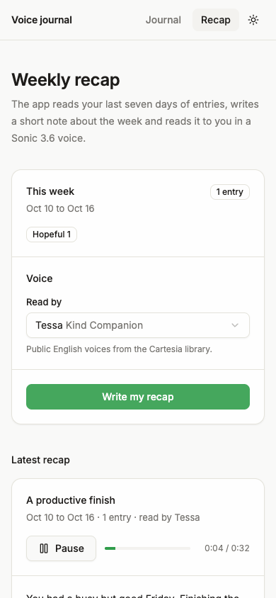

# Voice journal: an AI voice diary app in Expo with Cartesia speech to text and text to speech

An Expo (React Native) voice journal for iOS, Android and the web. Tap to record an entry, Cartesia Ink (`ink-whisper`) transcribes it, an LLM adds a title, a mood and a one-line reflection, and once a week the app writes a short recap and reads it aloud with a Cartesia Sonic 3.6 voice you pick. Entries stay on the device. A few Expo Router API routes hold the keys, so it runs with API keys only: no database, no login.



## Run it

```sh
pnpm dlx create-expo-app@latest my-journal --template https://github.com/cartesia-ai/cookbook/tree/main/examples/voice-journal
cd my-journal
cp .env.example .env.local   # add CARTESIA_API_KEY, LLM_MODEL and the matching provider key
pnpm dev
```

Press `w` to open the web app at http://localhost:8081, or scan the QR code with Expo Go. Tap Start recording, talk for a few seconds, tap Stop and save. Then open Recap and tap Write my recap.

If a key is missing, the app says which one. Node 22.13 or newer.

## Environment variables

| Name | Required | Where to get it |
| --- | --- | --- |
| `CARTESIA_API_KEY` | yes | https://play.cartesia.ai/keys |
| `LLM_MODEL` | yes | `provider/model`, for example `openai/gpt-5.4-mini` |
| `OPENAI_API_KEY` | if `LLM_MODEL` starts with `openai/` | https://platform.openai.com/api-keys |
| `ANTHROPIC_API_KEY` | if `LLM_MODEL` starts with `anthropic/` | https://console.anthropic.com |
| `AI_GATEWAY_API_KEY` | for any other provider | https://vercel.com/docs/ai-gateway |

None of these have an `EXPO_PUBLIC_` prefix, so Expo never puts them in the app bundle. Only the API routes in `app/api` read them. Model ids are examples; providers retire models, so check the provider's model page first.

## How it works

1. `lib/use-recorder.ts` records with `expo-audio` (m4a on iOS and Android, WebM on the web) and shows a level meter from the recorder's metering.
2. The app posts the file to `POST /api/transcribe`, which sends it to Cartesia `ink-whisper` and returns the text. The entry is saved right away with its transcript.
3. `POST /api/analyze` asks the LLM for a title, one mood from a fixed list and a one-sentence reflection, using the AI SDK with a zod schema (`lib/schema.ts`). If this step fails, the entry keeps its transcript and the entry page shows Retry.
4. On the Recap page, `POST /api/recap` gets the last seven days of entries (oldest first) and writes a 120 to 200 word recap meant to be heard, not read.
5. `POST /api/speak` turns the recap into an MP3 with Sonic 3.6 and returns the bytes. The app plays it with `expo-audio`: from a `blob:` URL on the web, from a file in the cache directory on a phone.

```ts
const res = await getCartesia().tts.generate({
  model_id: "sonic-3.6",
  transcript: text,
  voice: { mode: "id", id: voiceId },
  language: "en",
  output_format: { container: "mp3", sample_rate: 44100, bit_rate: 128000 },
});
return new Response(await res.arrayBuffer(), { headers: { "Content-Type": "audio/mpeg" } });
```

```
app/index.tsx              record, progress, latest entry, entries by day with search
app/entry/[id].tsx         reflection, transcript, retry, delete
app/recap.tsx              this week, voice picker, recap player, earlier recaps
app/api/transcribe+api.ts  ink-whisper
app/api/analyze+api.ts     title, mood, reflection (LLM)
app/api/recap+api.ts       weekly recap (LLM)
app/api/speak+api.ts       Sonic 3.6 MP3
app/api/voices+api.ts      public English voices for the picker
app/api/health+api.ts      booleans for the setup banner
lib/store.ts               the only file that touches storage (AsyncStorage)
lib/server/                Cartesia client, LLM resolver, prompts, error mapping
components/ui, blocks      the cookbook kit rebuilt in React Native
```

Audio is not stored. The transcribe route reads the file, sends it to Cartesia and forgets it. Entries, recaps and the chosen voice live in AsyncStorage, which is `localStorage` on the web and a local file on iOS and Android.

## Models and API version

`ink-whisper` for file transcription, `sonic-3.6` for speech, through `@cartesia/cartesia-js`, which sends `Cartesia-Version: 2026-08-14`. Current model ids: https://docs.cartesia.ai/build-with-cartesia/tts-models/latest and https://docs.cartesia.ai/build-with-cartesia/stt/latest.

## Change it

- Use a different default voice: set `DEFAULT_VOICE_ID` in `lib/limits.ts` to any voice id from https://play.cartesia.ai/voices. The picker lists public English voices from `GET /voices`.
- Transcribe another language: change `language: "en"` in `app/api/transcribe+api.ts`, and the TTS `language` in `app/api/speak+api.ts` with a voice that speaks it.
- Change the moods or the tone of the reflection: edit `MOODS` in `lib/schema.ts` and the prompts in `lib/server/prompts.ts`.
- Swap the LLM: set `LLM_MODEL`. `lib/server/llm.ts` is the whole switch.
- Store entries elsewhere: replace the functions in `lib/store.ts` and keep `useJournal()`.

## FAQ

### How do I keep my Cartesia API key out of the app?

The key is only read in `lib/server/cartesia.ts`, which only API routes import, and it has no `EXPO_PUBLIC_` prefix, so Metro never inlines it into the client bundle. If you want the phone to call Cartesia directly instead, mint a short-lived access token on the server, as in [Browser auth with access tokens](../../content/cookbook/00-guides/01-browser-auth-with-access-tokens.mdx).

### Does it work on a real iPhone or Android phone?

Yes, in Expo Go during development: the app calls the API routes on the Expo dev server, which Expo Router resolves for you. For a store build, deploy the server (for example `eas deploy` to EAS Hosting) and set the `origin` option of the `expo-router` plugin in `app.json` to that URL. The web and native paths were checked in headless Chrome; the native paths compile but were not run on a device for this template.

### Why ink-whisper and not Ink 2 streaming?

A journal entry is a finished recording, so one batch request is simpler and needs no WebSocket. Ink 2 (`/stt/turns/websocket`) needs raw PCM chunks while you talk. `expo-audio` 58 has `useAudioStream` for that on iOS and Android, but on the web it returns no stream, so live captions would need a second code path. That is the next step if you want words on screen as you speak.

### Is this a therapy app?

No. The prompts tell the model not to diagnose or give medical advice, and to point to someone they trust or a local crisis line if an entry mentions self-harm. Treat the reflections as a mirror, not advice.

### Can I use my own voice for the recap?

Not in this template. Voice cloning was left out on purpose, so the app only uses voices from the Cartesia library.

## Before you deploy

The API routes have no auth. Anyone who finds the URL can spend your Cartesia and LLM credits. Put them behind your own login or a rate limiter first. Entries are sent to Cartesia and your LLM provider for processing; tell your users that.

## Learn more

- Cartesia docs: https://docs.cartesia.ai
- Batch STT: https://docs.cartesia.ai/api-reference/stt/transcribe
- TTS bytes: https://docs.cartesia.ai/use-the-api/compare-tts-endpoints
- Expo Router API routes: https://docs.expo.dev/router/web/api-routes/
- Agent skills: `npx skills add cartesia-ai/skills`

## License

Apache-2.0, like the rest of the [Cartesia cookbook](https://github.com/cartesia-ai/cookbook/blob/main/LICENSE).
